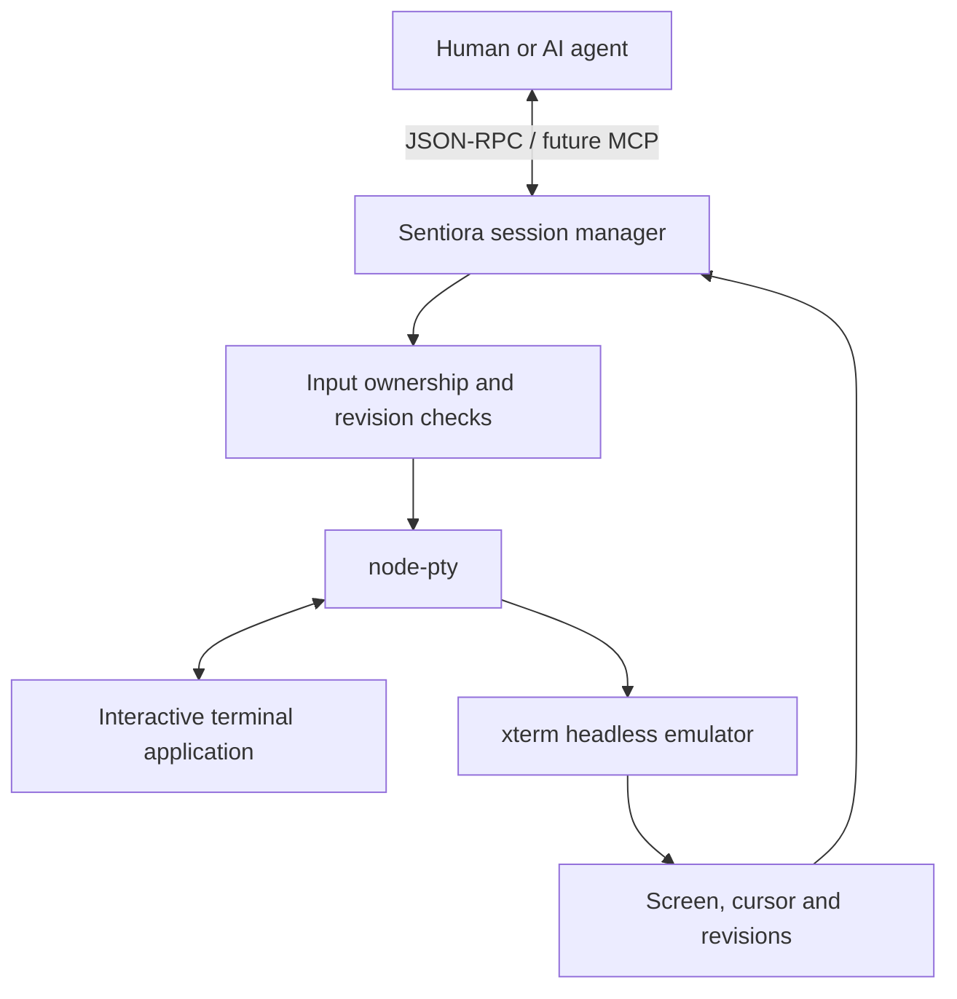
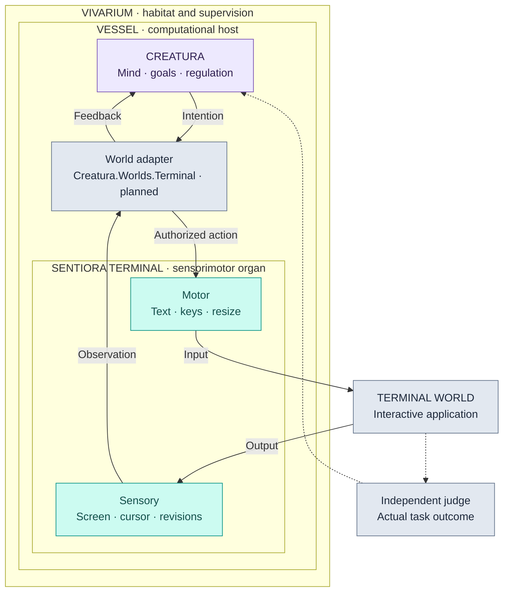

<div align="center">

# Sentiora Terminal

### Give intelligence senses.

**Cross-platform terminal perception and interaction for humans and AI agents.**


[Vision](#vision) · [Architecture](#architecture) · [Developer experience](#developer-experience) · [Roadmap](#roadmap) · [Creatura](#the-creatura-ecosystem)

</div>

> Intelligence is not enough. To act in the world, an agent must first be able to perceive it.

## Vision

Sentiora takes its name from the Latin *sentire*: to feel, sense or perceive. It is a proposed sensorimotor interface for artificial intelligence, beginning with the terminal.

Think of it as **Playwright for terminals**. Instead of treating a command-line application as a one-shot subprocess, Sentiora aims to let an agent observe a living interactive session, understand its current state, act through keyboard input and observe the consequences.

Many developer tools, installers, interactive menus and terminal user interfaces are designed for people. A stream of stdout alone is not a faithful representation of what a person sees. Sentiora bridges that gap.

## What makes it different?

| Traditional process execution | Sentiora's intended model |
| --- | --- |
| Run a command and collect output | Maintain an interactive session |
| Read stdout and stderr | Observe the rendered terminal screen and cursor |
| Send a line of input | Type, press keys and navigate interactive controls |
| Wait for process exit | Wait for observable changes or exit |
| Assume output describes reality | Expose observations for independent verification |

## Architecture



The runtime is deliberately model-agnostic. Sentiora supplies perception and action; the caller supplies goals, reasoning, authorization and independent verification.

### Technology choices

- **Node.js and TypeScript:** portable runtime and typed contracts.
- **node-pty:** native pseudoterminals, including Windows ConPTY and Unix PTYs.
- **@xterm/headless:** terminal emulation without a browser.
- **JSON-RPC:** initial local transport over stdio.
- **C# SDK:** planned first-class .NET integration.
- **MCP and Python SDK:** planned additional integration surfaces.

### Target platforms

| Platform | Backend | Target architectures |
| --- | --- | --- |
| Linux | Unix PTY | x64, ARM64 |
| macOS | Unix PTY | Intel, Apple Silicon |
| Windows | ConPTY | x64, ARM64 |

These are targets, not a verified compatibility matrix. Native dependency packaging and real interactive tests must pass before a platform is declared supported.

## Developer experience

The following examples illustrate the intended API, not a published SDK.

```csharp
// Proposed C# API
await using var session = await terminal.CreateAsync("my-interactive-tool");
var screen = await session.ObserveAsync();
await session.TypeAsync("help", expectedRevision: screen.Revision);
await session.PressKeyAsync("Enter");
var next = await session.WaitForChangeAsync(screen.Revision);
```

A session should expose structured observations such as:

```json
{
  "sessionId": "example",
  "revision": 12,
  "visibleText": "Select an option:\n> Continue\n  Cancel",
  "cursor": { "x": 2, "y": 1 },
  "running": true
}
```

The agent can choose an action based on this observation. Revision checks and exclusive input ownership help prevent accidental actions against a changed screen.

### Initial protocol surface

| Operation | Purpose |
| --- | --- |
| initialize | Negotiate protocol capabilities |
| terminal.create | Start an interactive process |
| terminal.list | Enumerate sessions |
| terminal.observe | Read screen and process state |
| terminal.type | Send text |
| terminal.key | Send a keyboard event |
| terminal.wait | Wait for change or exit |
| terminal.resize | Change terminal dimensions |
| terminal.close | End a session |

The protocol is provisional until the implementation and contract tests land.

## The Creatura ecosystem

Sentiora is independent, but its first planned integration is [Creatura](https://github.com/egarim/creatura), an agent framework inspired by cognitive architecture and regulation.

| Concept | Role |
| --- | --- |
| Creatura | Cognition, goals and regulation |
| Vessel | Computational host |
| Sentiora Terminal | Terminal perception and action |
| World | Environment and observable effects |
| Vivarium | Habitat and supervision |



**Creatura thinks. Sentiora senses and acts. The Vessel hosts. The World responds.**

This is the intended embodiment architecture, not a claim that the integration is already shipped. Sentiora is an independent runtime; the World adapter and independent task judge belong to the Creatura integration. Vivarium represents the supervisory habitat, not a required runtime dependency.

The integration is tracked in [Creatura #101](https://github.com/egarim/creatura/issues/101), with the adapter in [#102](https://github.com/egarim/creatura/issues/102), verification in [#103](https://github.com/egarim/creatura/issues/103), distribution in [#104](https://github.com/egarim/creatura/issues/104) and documentation in [#105](https://github.com/egarim/creatura/issues/105).

## Roadmap

- [ ] Native PTY runtime and synchronized headless screen perception
- [ ] Session lifecycle, revision tracking, input ownership and bounded history
- [ ] Versioned JSON-RPC protocol and deterministic interactive fixture
- [ ] Cross-platform CI and native integration tests
- [ ] C# SDK and contract tests
- [ ] Creatura real and simulated terminal worlds
- [ ] MCP server and Python SDK
- [ ] Browser-based human takeover
- [ ] Authenticated remote sessions and distributed execution

## Security and responsible automation

Terminal output is untrusted data, not instructions. A terminal can display misleading messages, request credentials or attempt prompt injection. Callers must enforce least privilege, explicit approval policies, bounded execution and independent verification of outcomes.

Sentiora is not intended to bypass authentication, permission gates, subscription restrictions or provider terms. Credentials should remain outside logs and repositories. Remote access must be authenticated, authorized and encrypted.

## Getting started

The initial JavaScript ESM runtime and CI configuration are now in this repository. Native platform validation is pending; SDKs are not yet published.

```bash
npm install
npm test
npm start
```

The server communicates over newline-delimited JSON-RPC on stdio. See [CI results](https://github.com/egarim/sentiora-terminal/actions) for validation progress.

## Contributing

Ideas, terminal fixtures, platform-specific test cases and design feedback are welcome. Open an [issue](https://github.com/egarim/sentiora-terminal/issues) to discuss a proposal. Prefer small, testable changes and explicit documentation of platform limitations.

## License

See the repository's license file for the applicable terms.

---

<div align="center">

**Sentiora Terminal — Give intelligence senses.**

Built for humans, agents and the space between them.

</div>
