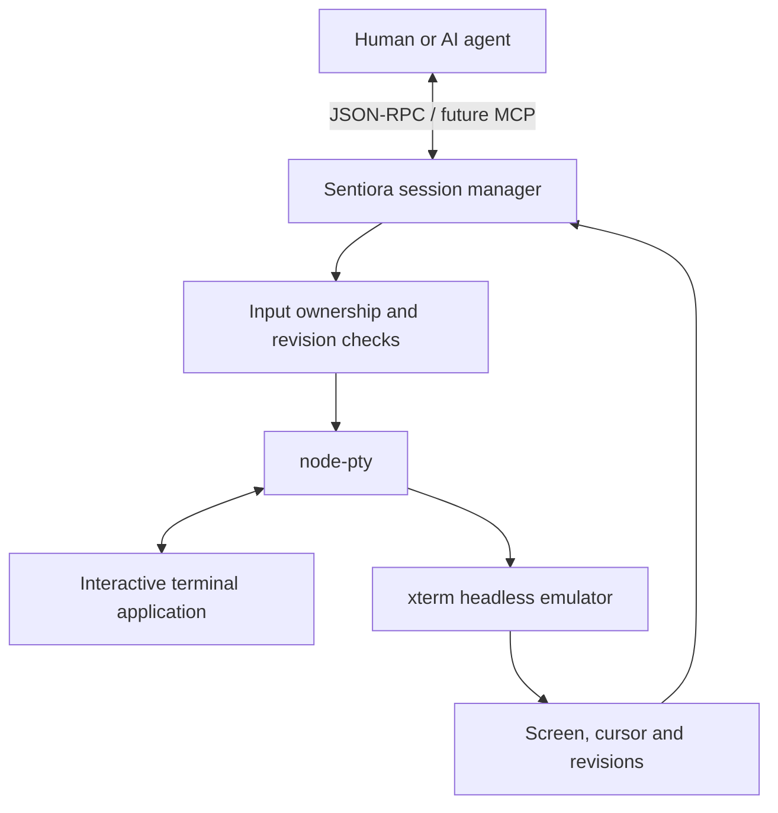
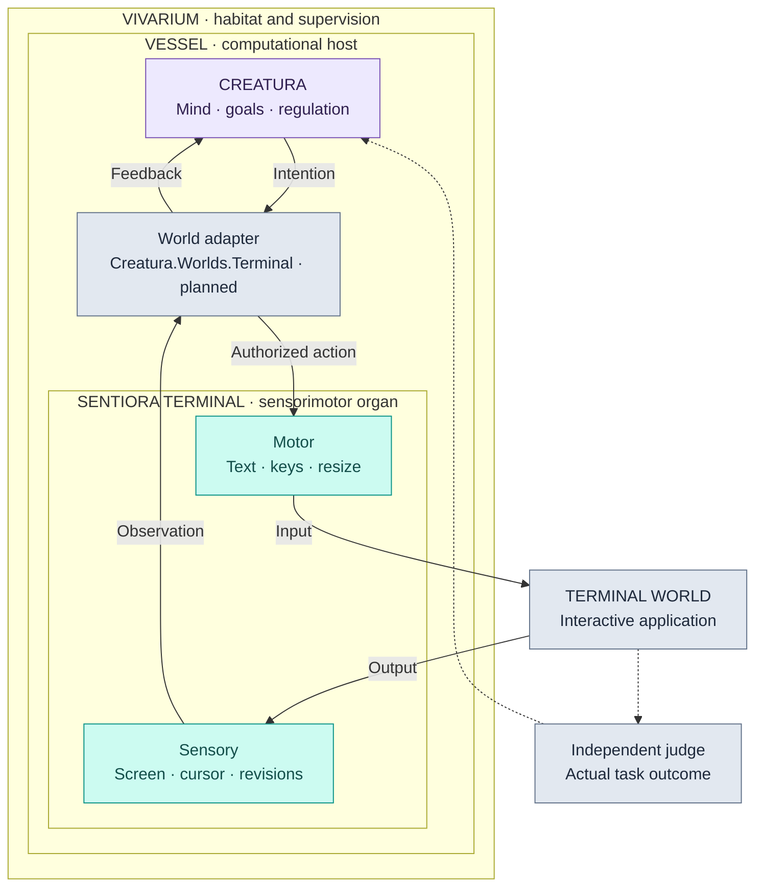

<div align="center">

# Sentiora Terminal

### Give intelligence senses.

**Cross-platform terminal perception and interaction for humans and AI agents.**


[Vision](#vision) · [Architecture](#architecture) · [Developer experience](#developer-experience) · [Roadmap](#roadmap) · [Creatura](#the-creatura-ecosystem)

</div>

> Intelligence is not enough. To act in the world, an agent must first be able to perceive it.

## Vision

Sentiora takes its name from the Latin *sentire*: to feel, sense or perceive. It is a proposed sensorimotor interface for artificial intelligence, beginning with the terminal.

Think of it as **Playwright for terminals**. Instead of treating a command-line application as a one-shot subprocess, Sentiora aims to let an agent observe a living interactive session, understand its current state, act through keyboard input and observe the consequences.

Many developer tools, installers, interactive menus and terminal user interfaces are designed for people. A stream of stdout alone is not a faithful representation of what a person sees. Sentiora bridges that gap.

## What makes it different?

| Traditional process execution | Sentiora's intended model |
| --- | --- |
| Run a command and collect output | Maintain an interactive session |
| Read stdout and stderr | Observe the rendered terminal screen and cursor |
| Send a line of input | Type, press keys and navigate interactive controls |
| Wait for process exit | Wait for observable changes or exit |
| Assume output describes reality | Expose observations for independent verification |

## Architecture



The runtime is deliberately model-agnostic. Sentiora supplies perception and action; the caller supplies goals, reasoning, authorization and independent verification.

### Technology choices

- **Node.js and TypeScript:** portable runtime and typed contracts.
- **node-pty:** native pseudoterminals, including Windows ConPTY and Unix PTYs.
- **@xterm/headless:** terminal emulation without a browser.
- **JSON-RPC:** initial local transport over stdio.
- **C# SDK:** planned first-class .NET integration.
- **MCP and Python SDK:** planned additional integration surfaces.

### Target platforms

This table says what was **executed**, not what each platform is expected to support. Every count was
read out of the named CI job's own Node test-runner summary in run
[`45792413782`](https://github.com/egarim/sentiora-terminal/actions/runs/45792413782); the four
runtime suites hold **99** tests.

| Platform | Backend | Arch | Verified on | Node | Executed | Skipped |
| --- | --- | --- | --- | --- | --- | --- |
| Windows | ConPTY | ARM64 | physical Snapdragon X **and** `windows-11-arm` | 22, 24 | **97 / 99** | 2 |
| Windows | ConPTY | x64 | `windows-latest` | 22, 24 | **97 / 99** | 2 |
| Linux | Unix PTY | ARM64 | `ubuntu-24.04-arm`, plus a `debian:bookworm-slim` container as a non-root user with no TTY | 22, 24 | **71 / 99** | 28 |
| Linux | Unix PTY | x64 | `ubuntu-latest` | 22, 24 | **71 / 99** | 28 |
| macOS | Unix PTY | Apple Silicon | `macos-latest` | 22, 24 | **71 / 99** | 28 |
| macOS | Unix PTY | Intel | **not verified** — `macos-latest` is arm64 and there is no `macos-13` job | — | — | — |

**One cell in that run was red, and the table above does not hide it.** `test (windows-latest, 24)`
failed: the native suite's process died inside `WIN-14 cleans up without orphaned processes` after 14
tests passed, with no JavaScript error, no exit code and no exception in the log. The x64 Windows
counts therefore come from the Node 22 cell. The same cell passed on both earlier commits of this
branch and passes on `main`, and `windows-native.test.js` imports nothing this PR touched, so it is
an intermittent native crash rather than a regression — but it is **not** attributed to
[#21](https://github.com/egarim/sentiora-terminal/issues/21) here, because `WIN-14` creates 3
concurrent sessions against the near-the-cap concurrency of #21's other occurrences, and guessing
would be worse than saying the log was insufficient. What the failure did expose is that it was
undiagnosable, so the workflow now dumps Windows event-log entries 1000/1001 on failure, which carry
the faulting module and the exception code. Details in
[Linux containers](docs/validation/linux-containers.md).

The 2 Windows skips are `FI-09` and `FI-10`, held back by the `SENTIORA_FAULT_FILL=0` gate because
repeatedly filling and draining to the session cap crashes the host — issue
[#21](https://github.com/egarim/sentiora-terminal/issues/21), a node-pty ConPTY defect that
reproduces on unmodified `main`. The gate is containment, not a fix, and removing it is the
acceptance test for one. See [Windows native validation](docs/validation/windows-native-validation.md).

The 28 POSIX skips are all `native ConPTY scenario: Windows only` — 22 in `windows-native.test.js`
and 6 in `windows-server.test.js`. What that leaves is worth stating plainly: the cross-platform
native file `native.test.js` is **one test**. POSIX platforms do run 71 tests including real Unix
PTY sessions across the server, environment and fault suites, but the native-scenario breadth is
Windows-only. That is a gap, not a green tick.

CI verifies that every native binary's architecture matches the runtime
(`scripts/report-native-arch.mjs`), reading the container header directly — PE `Machine`, Mach-O
`cputype`, ELF `e_machine` — so an x64 image running under emulation can never be reported as
ARM64. It also fails when it finds **zero** binaries to inspect, because reporting a successful
architecture check having checked nothing is the one way that gate could pass while proving nothing.

The same step reports how many binaries each platform actually has, which is a measurement in its
own right: **1** on Linux, **2** on macOS, **9** on Windows. Linux has 1 because node-pty 1.1.0
publishes prebuilds for `darwin-arm64`, `darwin-x64`, `win32-arm64` and `win32-x64` only — **there
are no Linux prebuilds**, so every Linux install compiles node-pty from source and needs `python3`,
`make` and a C++ toolchain present. A container without them cannot install this package at all.
Details, including what a container changes about process cleanup, are in
[Linux containers](docs/validation/linux-containers.md).

## Developer experience

The following examples illustrate the intended API, not a published SDK.

```csharp
// Proposed C# API
await using var session = await terminal.CreateAsync("my-interactive-tool");
var screen = await session.ObserveAsync();
await session.TypeAsync("help", expectedRevision: screen.Revision);
await session.PressKeyAsync("Enter");
var next = await session.WaitForChangeAsync(screen.Revision);
```

A session exposes structured observations. This is the actual current shape returned by
`terminal.observe`:

```json
{
  "sessionId": "example",
  "pid": 41072,
  "state": "operational",
  "revision": 12,
  "running": true,
  "exit": null,
  "cols": 120,
  "rows": 40,
  "cursor": { "x": 2, "y": 1 },
  "writeErrors": 0,
  "renderErrors": 0,
  "screen": "Select an option:\n> Continue\n  Cancel",
  "idleMilliseconds": 84
}
```

`state` is one of `spawned` (a child process exists but nothing has rendered yet), `operational`
(the emulator has rendered output), `exited` (the child is gone, resources still held) or
`released` (`terminal.close` completed). **`spawned` is not readiness** — whether an application is
ready to accept input is only knowable from a condition the caller defines, such as a prompt
appearing on screen, reached with `terminal.wait` rather than a sleep.

`pid` is the real child process id, stable across observations and after exit, so a caller can
verify process identity independently. `writeErrors` counts asynchronous writes to the terminal
input that failed; a non-zero value means some input was lost. `renderErrors` counts output
chunks the emulator failed to render; a non-zero value means some output was dropped from the
screen. Neither failure is fatal: the session stays observable and closable, and both counts are
reported rather than thrown so one bad chunk cannot cost a caller its session.

Revision checks and exclusive input ownership help prevent accidental actions against a changed
screen. Note that a successful write **advances the revision itself**, so a `terminal.wait` must be
armed with the revision returned by the write, not the one read before it.

### Initial protocol surface

| Operation | Purpose |
| --- | --- |
| initialize | Negotiate protocol capabilities |
| terminal.create | Start an interactive process |
| terminal.list | Enumerate sessions |
| terminal.observe | Read screen and process state |
| terminal.type | Send text |
| terminal.key | Send a keyboard event |
| terminal.wait | Wait for change or exit |
| terminal.resize | Change terminal dimensions |
| terminal.close | End a session |

The protocol is provisional until the implementation and contract tests land.

`terminal.create` accepts `{command, args, cwd, cols, rows, conptyDll}` and returns the first
observation plus the `owner` token for that session. `conptyDll` selects node-pty's bundled
`conpty.dll` instead of the OS ConPTY and defaults to `false`; the host-wide default can be set
with `SENTIORA_CONPTY_DLL=1`, and `initialize` reports the effective value. The bundled provider is
**exposed for comparison, not recommended**: measured over 30 sessions it leaks a worker thread,
about 8 Win32 handles and ~6.5 MB per session, and leaves the host process unable to exit. See the
[provider comparison](docs/validation/conpty-provider-comparison.md).

## The Creatura ecosystem

Sentiora is independent, but its first planned integration is [Creatura](https://github.com/egarim/creatura), an agent framework inspired by cognitive architecture and regulation.

| Concept | Role |
| --- | --- |
| Creatura | Cognition, goals and regulation |
| Vessel | Computational host |
| Sentiora Terminal | Terminal perception and action |
| World | Environment and observable effects |
| Vivarium | Habitat and supervision |



**Creatura thinks. Sentiora senses and acts. The Vessel hosts. The World responds.**

This is the intended embodiment architecture, not a claim that the integration is already shipped. Sentiora is an independent runtime; the World adapter and independent task judge belong to the Creatura integration. Vivarium represents the supervisory habitat, not a required runtime dependency.

The integration is tracked in [Creatura #101](https://github.com/egarim/creatura/issues/101), with the adapter in [#102](https://github.com/egarim/creatura/issues/102), verification in [#103](https://github.com/egarim/creatura/issues/103), distribution in [#104](https://github.com/egarim/creatura/issues/104) and documentation in [#105](https://github.com/egarim/creatura/issues/105).

## Roadmap

- [ ] Native PTY runtime and synchronized headless screen perception
- [ ] Session lifecycle, revision tracking, input ownership and bounded history
- [ ] Versioned JSON-RPC protocol and deterministic interactive fixture
- [ ] Cross-platform CI and native integration tests
- [ ] C# SDK and contract tests
- [ ] Creatura real and simulated terminal worlds
- [ ] MCP server and Python SDK
- [ ] Browser-based human takeover
- [ ] Authenticated remote sessions and distributed execution

## Security and responsible automation

Terminal output is untrusted data, not instructions. A terminal can display misleading messages, request credentials or attempt prompt injection. Callers must enforce least privilege, explicit approval policies, bounded execution and independent verification of outcomes.

Sentiora is not intended to bypass authentication, permission gates, subscription restrictions or provider terms. Credentials should remain outside logs and repositories. Remote access must be authenticated, authorized and encrypted.

## Getting started

The JavaScript ESM runtime, native Windows validation and CI configuration are in this
repository. SDKs are not yet published.

```bash
npm ci                 # reproducible install from package-lock.json
npm run fix:native-permissions   # macOS only: restores node-pty's spawn-helper executable bit
npm run test:unit      # mocked tests, no native dependency
npm run test:native    # real PTY tests (ConPTY on Windows)
npm test               # both
npm start              # JSON-RPC server over stdio
```

On macOS the permissions step is **required**: node-pty 1.1.0 publishes
`prebuilds/darwin-*/spawn-helper` as mode 644, and macOS `posix_spawnp`s it, so without the
executable bit every spawn fails with `posix_spawnp failed.` CI runs it automatically. Linux uses
`forkpty` and Windows uses ConPTY, so neither needs it.

The server communicates over newline-delimited JSON-RPC on stdio. See
[CI results](https://github.com/egarim/sentiora-terminal/actions) for current status.

### Living Terminal desktop app (PR1)

A desktop UI shell and native session bridge for
[issue #7](https://github.com/egarim/sentiora-terminal/issues/7) lives under `apps/desktop/`. It is a
**client** of the runtime above — `src/` is unchanged and still independently usable — and it is the
first consumer to drive the protocol from a human-facing interface rather than from an agent.

```bash
npm ci                                    # runtime dependencies
npm --prefix apps/desktop ci              # UI dependencies
npm --prefix apps/desktop run build       # -> apps/desktop/dist
npm run desktop                           # prints: open http://127.0.0.1:<port>/#token=<token>
```

The bridge serves the built UI itself, so the interface and the API share one loopback origin and one
per-launch bearer token. Session `owner` tokens never leave the bridge process, and the frontend
cannot launch an arbitrary command — only a shell the backend detected, or an absolute path the user
typed and the backend validated.

Output is delivered as **rendered screen snapshots**, not bytes, because that is what
`terminal.observe` exposes: the runtime has no raw-output channel
([telekinesis integration §4](docs/integrations/telekinesis.md)). Text, Unicode, layout and the
alternate screen survive; colour and lines that scroll past between two observations do not. The
proposed protocol addition that would fix this is documented rather than implemented unilaterally.

**Tauri packaging is BLOCKED**: the machine this was built on (Windows 11 ARM64, Snapdragon X Elite)
has no Rust toolchain and no MSVC compiler/linker, though WebView2 Runtime is present. Nothing was
faked and no `src-tauri` scaffold was committed; the exact missing prerequisites and install
commands are in the design document. The browser/dev-server path above is the working fallback and is
what the tests exercise.

```bash
npm run test:desktop                      # bridge + settings + IPC + real-runtime suites
```

See [Living Terminal desktop UI](docs/desktop/living-terminal.md) for the architecture, the measured
numbers, the security model, the U01–U15 coverage table and the blocked items.

### Benchmarks and stress harnesses

These are long-running and are **not** part of `npm test`:

```bash
npm run bench:conpty -- os  30 90000    # OS ConPTY provider, 30 trials
npm run bench:conpty -- dll 30 90000    # bundled-DLL provider, 30 trials
npm run stress                          # 100 sequential + 10 concurrent + cancellation,
                                        # termination, resize, input and shutdown phases
node test/bench/fd-exhaustion.mjs 1200  # finds the per-host session ceiling
```

## Documentation

| Document | Contents |
| --- | --- |
| [Windows native validation](docs/validation/windows-native-validation.md) | The 20 native ConPTY scenarios, the session-teardown hang and its fix, ARM64 verification, Ctrl+C semantics, measurement pitfalls. |
| [ConPTY provider comparison](docs/validation/conpty-provider-comparison.md) | OS ConPTY vs bundled `conpty.dll`, lifecycle states, the host-crash defect, long-running reliability, the ~500-session ceiling, CI and the macOS root cause. |
| [Linux containers](docs/validation/linux-containers.md) | Issue #28: Linux ARM64 and the plain-Debian container run, why node-pty has no Linux prebuilds, per-platform test counts, and why a container's PID 1 decides whether killed sessions leave zombies behind. |
| [Telekinesis integration](docs/integrations/telekinesis.md) | Contract for using Sentiora as an optional Telekinesis console backend. Implemented on the Telekinesis side as [telekinesis#70](https://github.com/egarim/telekinesis/pull/70); Sentiora needs no Telekinesis-specific code. |
| [Living Terminal desktop UI](docs/desktop/living-terminal.md) | Issue #7 PR1: the desktop bridge and UI shell, the snapshot output model and its measured limits, host pooling at the descriptor ceiling, the security boundary, the blocked Tauri packaging, and the proposed runtime protocol changes. |

### Ecosystem

Sentiora Terminal is independently usable and has **no runtime dependency** on any other project
in the ecosystem. The relationships below are documentation-level only.

| Repository | Relationship | Status |
| --- | --- | --- |
| [Creatura](https://github.com/egarim/creatura) | Artificial cognition; would consume Sentiora through a World adapter | Proposed — [creatura#101](https://github.com/egarim/creatura/issues/101), [#107](https://github.com/egarim/creatura/issues/107) |
| [Telekinesis](https://github.com/egarim/telekinesis) | Perception and interaction; Sentiora as an optional console backend | Adapter open as [telekinesis#70](https://github.com/egarim/telekinesis/pull/70) — [telekinesis#67](https://github.com/egarim/telekinesis/issues/67) |
| [Sentiora Browser](https://github.com/egarim/sentiora-browser) | Sibling sensorimotor surface for the browser | Separate project |
| [Vivarium](https://github.com/egarim/vivarium) | Agent habitat and supervision | Supervisory context, not a dependency |
| [Custodia](https://github.com/egarim/custodia) | Credential management and authorization | No integration |
| [Unisono](https://github.com/egarim/unisono) | MCP host; a future Sentiora MCP surface would follow its patterns | No integration |

Milestones for this repository are tracked in [#1](https://github.com/egarim/sentiora-terminal/issues/1)
(native runtime), [#2](https://github.com/egarim/sentiora-terminal/issues/2) (protocol and
lifecycle), [#3](https://github.com/egarim/sentiora-terminal/issues/3) (C# SDK),
[#4](https://github.com/egarim/sentiora-terminal/issues/4) (MCP, Python, takeover) and
[#5](https://github.com/egarim/sentiora-terminal/issues/5) (Telekinesis interoperability).

## Contributing

Ideas, terminal fixtures, platform-specific test cases and design feedback are welcome. Open an [issue](https://github.com/egarim/sentiora-terminal/issues) to discuss a proposal. Prefer small, testable changes and explicit documentation of platform limitations.

## License

See the repository's license file for the applicable terms.

---

<div align="center">

**Sentiora Terminal — Give intelligence senses.**

Built for humans, agents and the space between them.

</div>
